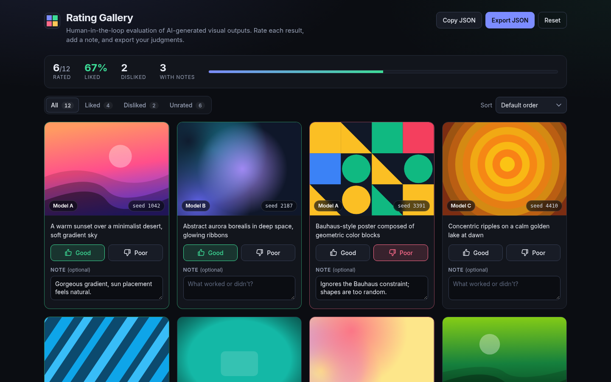

# Rating Gallery

A small interface for **human-in-the-loop evaluation of AI-generated images**. Browse a grid of outputs, give each one a thumbs up or down, add a note, then filter, sort and export your judgments as JSON. You can also generate new cards from a prompt or import your own local renders and rate them in the same loop.



**Live demo:** https://ratinggallery.vercel.app

**Stack:** React 18, TypeScript, Vite, a Vercel serverless function (`/api/generate`) that calls the Hugging Face Inference API with a fallback to Pollinations.ai, and browser `localStorage`. Runtime dependencies are `react` and `react-dom` only.

**Why I built this:** automated metrics only tell part of the story when you evaluate generative image models, so I wanted a fast, accessible surface for a person to judge prompt adherence and quality and export those judgments. Part of my portfolio Lab at https://www.abhidattasrichandan.com

## What it does

- **Side-by-side judgment.** 12 sample cards from several models and seeds sit in one grid, so reviewers compare like with like. The sample previews are drawn locally from a seed as inline SVG, so the base gallery needs no images, keys or network.
- **Low-friction labeling.** One click for a binary verdict (click again to clear), plus an optional note per card with debounced autosave.
- **Fast triage.** Filter by All, Liked, Disliked or Unrated with live counts. Sort by default order, rating high to low, rating low to high, or notes first. A summary bar shows rated x/N, % liked, disliked, notes and progress.
- **Generate a card (experimental, free models).** A prompt (up to 300 characters) goes to the `/api/generate` server function. It tries the Hugging Face Inference API first, only if an `HF_TOKEN` is configured, then falls back to the free, keyless Pollinations.ai API (flux) with one retry. If that fails, the browser tries Pollinations.ai directly, and if live generation is still unavailable the UI adds one of six pre-generated sample images from `public/samples/` instead of showing a raw error.
- **Import local images.** Add PNG, JPG or WebP files (built for Draw Things exports). Files are read in the browser, downscaled to 768 px and saved locally; nothing is uploaded. Prompt, seed, steps and model are prefilled when found in the PNG's text metadata (XMP or A1111-style `parameters`), and each imported card can be edited or removed.
- **Portable results.** Export the labeled set as a JSON file or copy it to the clipboard. Reset asks for confirmation and offers an 8-second Undo.
- **Accessible by default.** Native buttons with `aria-pressed`, labelled form fields, a skip link, visible focus, live-region announcements and reduced-motion support.
- **Light and dark themes.** Dark by default, with a toggle in the demo bar; the choice is saved, and `?theme=light` or `?theme=dark` overrides it.

## Security note

The Hugging Face token is read only from the server-side environment variable `HF_TOKEN` inside the Vercel function. It is never sent to the browser, logged or returned. Do not prefix it with `VITE_`, because Vite would inline it into the client bundle. The endpoint has no rate limiting or authentication, and free Hugging Face accounts may have no inference credits (the function then falls back as described above).

## Getting started

Requires Node.js 20.19 or newer.

```bash
npm install
npm run dev
```

Open the URL Vite prints (default http://localhost:5173). `npm run dev` serves the front end only; to try `/api/generate` locally, run `vercel dev` instead. Copy `.env.example` to `.env` and set `HF_TOKEN` (optional) and `HF_IMAGE_MODEL` (optional; the code defaults to `stabilityai/stable-diffusion-3-medium-diffusers`).

## Scripts

| Script              | Description                                                   |
| ------------------- | ------------------------------------------------------------- |
| `npm run dev`       | Start the Vite dev server                                     |
| `npm run build`     | Type-check the app and the API function, then build with Vite |
| `npm run preview`   | Serve the production build locally                            |
| `npm run typecheck` | Type-check the app and the API function only                  |

## Export format

```json
{
  "exportedAt": "2026-01-01T12:00:00.000Z",
  "total": 12,
  "items": [
    { "id": "s01", "model": "Model A", "seed": 1042, "prompt": "...", "rating": "up", "note": "..." }
  ]
}
```

`rating` is `"up"`, `"down"` or `null` (unrated). Imported cards also carry `source: "local-import"`, `fileName`, `steps`, `settingsNote` and `metadataReadFrom`.

## Project structure

```
rating-gallery/
├── api/generate.ts           # Vercel function: Hugging Face first, Pollinations.ai fallback
├── docs/screenshot.png
├── public/
│   ├── favicon.svg
│   └── samples/              # six pre-generated fallback images
├── src/
│   ├── components/
│   │   ├── Card.tsx          # preview, rating, debounced note, imported-card metadata editor
│   │   ├── DemoBar.tsx       # shared header linking back to the portfolio Lab
│   │   ├── GeneratePanel.tsx # prompt form and fallback chain
│   │   ├── ImportPanel.tsx   # local file import (drag and drop or file picker)
│   │   ├── Preview.tsx       # seeded inline-SVG "model output" generator
│   │   ├── SummaryBar.tsx
│   │   ├── ThemeToggle.tsx
│   │   └── Toolbar.tsx       # filter and sort controls
│   ├── data/samples.ts       # sample prompts, models, seeds, palettes
│   ├── hooks/useEntries.ts   # ratings and notes state with localStorage sync
│   ├── lib/
│   │   ├── exportRatings.ts  # JSON build, download, clipboard
│   │   ├── gallery.ts        # filter, sort, summary (pure functions)
│   │   ├── generated.ts      # /api/generate client, browser fallback, sample fallback
│   │   ├── imported.ts       # import, downscale and persistence of local images
│   │   ├── pngMeta.ts        # PNG text chunk parser (XMP and parameters)
│   │   ├── prng.ts           # deterministic PRNG for previews
│   │   ├── samples.json      # fallback sample prompts and files
│   │   └── storage.ts        # validated localStorage access
│   ├── App.tsx
│   ├── main.tsx
│   ├── theme.ts
│   ├── styles.css, light.css, demo-shell.css
│   └── types.ts
├── .env.example
├── index.html
├── package.json
├── tsconfig.json, tsconfig.api.json
├── vercel.json
└── vite.config.ts
```

## Deploy notes

Deploy to Vercel with the Vite defaults (framework preset Vite, build command `npm run build`, output directory `dist`). `api/generate.ts` deploys as a serverless function with a 60-second limit (`vercel.json`). Set `HF_TOKEN` under Project Settings > Environment Variables if you want the Hugging Face path. Ratings, notes, generated and imported cards are stored in each visitor's own browser, so nothing is shared between visitors.
