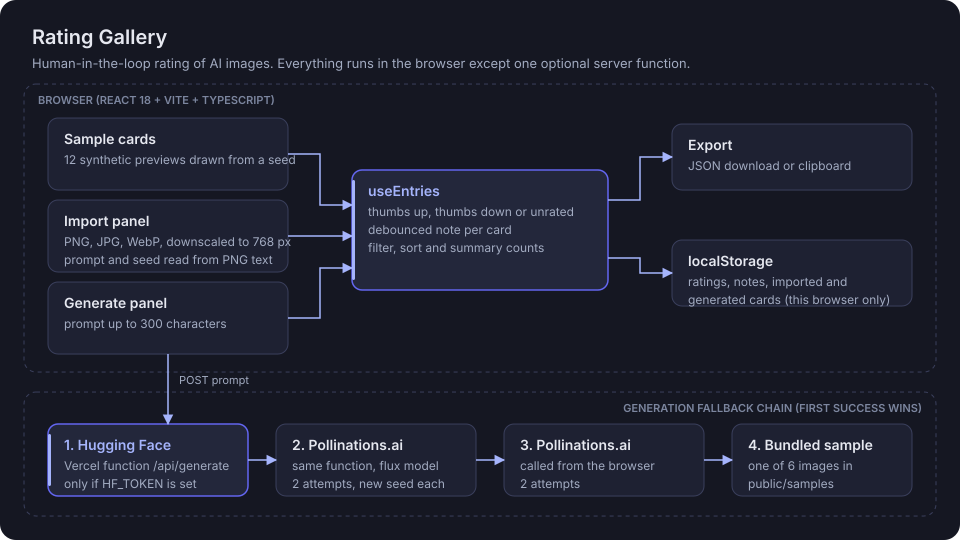

# Rating Gallery

**Rate AI-generated images by hand, add notes, and export your judgments as clean JSON.**

[](https://react.dev/)
[](https://www.typescriptlang.org/)
[](https://vite.dev/)
[](https://vercel.com/docs/functions)
[](package.json)

**Live demo:** https://ratinggallery.vercel.app

> **Example:** type `red fox resting in fresh snow`, press Generate, and a new card joins the grid. Give it a thumbs down, note "fox anatomy off, snow looks plastic", then filter to Disliked and export. You get one JSON file with the prompt, model, seed, verdict and note for every card.


## Architecture



Everything runs in the browser except one optional Vercel function, `api/generate.ts`. Ratings, notes and cards never leave the visitor's browser.

## How it works

1. **Cards come from three places.**
   - 12 sample cards whose previews are drawn locally as inline SVG from a seed and palette (`Preview.tsx`, `prng.ts`). Their model names ("Model A", "Model B", "Model C") are placeholders, not real models.
   - Local imports: PNG, JPG or WebP files are read in the browser and downscaled to 768 px. For PNGs, `pngMeta.ts` reads `tEXt` and uncompressed `iTXt` chunks (XMP or A1111-style `parameters`) to prefill prompt, seed, steps and model. It never invents a missing value.
   - Generated cards from a prompt of up to 300 characters (see the fallback chain below).
2. **The rating loop.** `useEntries` holds a thumbs up, thumbs down or unrated verdict per card and a debounced note. `gallery.ts` filters (All, Liked, Disliked, Unrated), sorts and computes the summary bar as pure functions.
3. **Persistence.** Ratings, notes and cards are validated and saved to `localStorage`. Large generated images (data URLs over 400,000 characters) stay in memory only.
4. **Export.** `exportRatings.ts` builds one JSON document and downloads it or copies it to the clipboard. Reset asks first and offers an 8-second Undo.

### Generation fallback chain

The first step that returns an image wins:

| Step | Where | Notes |
| --- | --- | --- |
| 1. Hugging Face Inference | `api/generate.ts` (server) | Only if `HF_TOKEN` is set. 15 s timeout. |
| 2. Pollinations.ai (flux) | `api/generate.ts` (server) | Free and keyless. 2 attempts with a new seed. |
| 3. Pollinations.ai (flux) | browser, `generated.ts` | Second chance from the visitor's browser. |
| 4. Bundled sample image | `public/samples/` | One of 6 pre-generated images, so the UI never shows a raw error. |

The function returns `{ image, latencyMs, model, provider }` on success and a structured error (`error`, `status`, `detail`) on failure. Images over 3 MB are rejected to stay under Vercel's response size limit.

## Export format

```json
{
  "exportedAt": "2026-01-01T12:00:00.000Z",
  "total": 12,
  "items": [
    { "id": "s01", "model": "Model A", "seed": 1042, "prompt": "...", "rating": "up", "note": "..." }
  ]
}
```

`rating` is `"up"`, `"down"` or `null`. Imported cards also carry `source`, `fileName`, `steps`, `settingsNote` and `metadataReadFrom`.

## Run locally

Requires Node.js 20.19 or newer.

```bash
npm install
cp .env.example .env    # optional, only for the Hugging Face path
npm run dev             # front end only, http://localhost:5173
vercel dev              # front end plus /api/generate
```

| Variable | Required | Purpose |
| --- | --- | --- |
| `HF_TOKEN` | No | Server-side Hugging Face token. Never prefix with `VITE_`. |
| `HF_IMAGE_MODEL` | No | Hugging Face model id. Code default: `stabilityai/stable-diffusion-3-medium-diffusers`. |

## Evaluation

This repo is itself an evaluation surface: the exported JSON is the result. There is no automated test suite yet. `npm run build` type-checks both the app and the API function before building.

## Honest limitations

- A personal portfolio prototype. It has no user accounts and no real users beyond whoever opens the demo.
- Ratings live in one browser's `localStorage`. Nothing is shared between reviewers, so there is no inter-rater agreement or aggregation.
- Binary verdicts only, no rubric or multi-criteria scoring.
- `/api/generate` has no rate limiting, authentication or monitoring. Free Hugging Face accounts may have no inference credits, in which case the function falls through to Pollinations.ai.
- The sample cards are synthetic SVG art, not real model outputs.
- No automated tests.

## Stack

React 18, TypeScript 5, Vite 7, plain CSS with variables, one Vercel serverless function (60 s max duration in `vercel.json`), browser `localStorage`.

Part of the Lab at https://www.abhidattasrichandan.com
